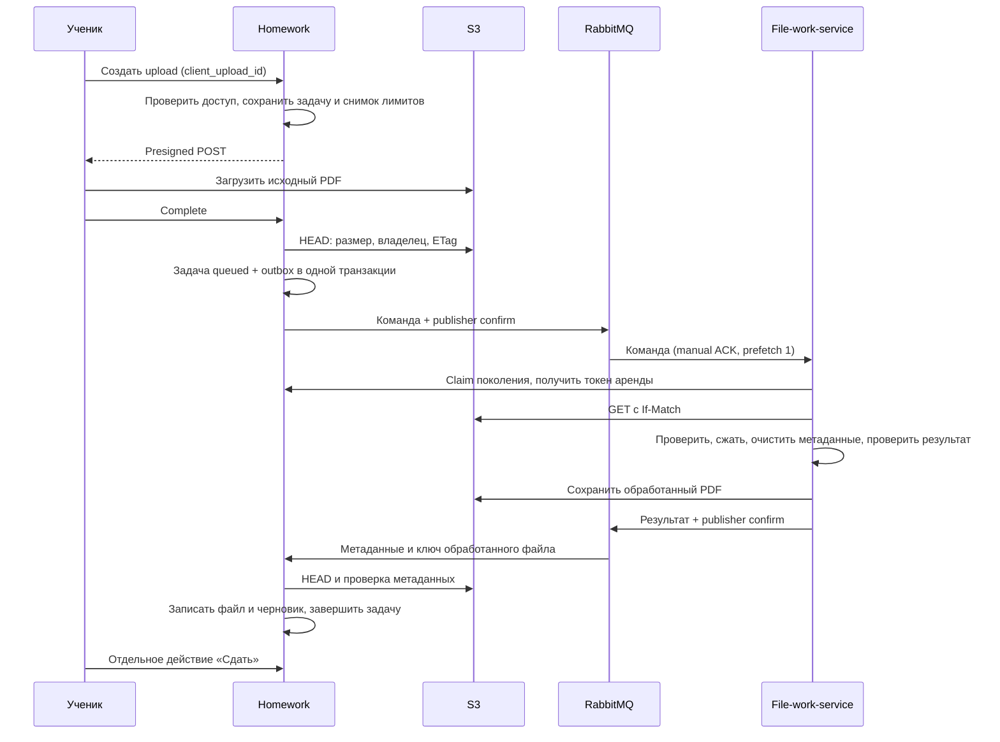

# Homework service

Go-сервис домашних работ. Владеет типами, заданиями, журналом, сдачей, проверкой, оценками и ссылками на файлы. Каждое задание и каждый тип принадлежат организации и конкретному подразделению. PDF обрабатывает отдельный `file-work-service`; он не подключается к предметной БД homework.

## Процесс файла



Байты PDF не проходят через API homework или RabbitMQ. До явной сдачи файл — приватный черновик ученика. Сотрудникам доступны сданные работы. Ручной журнал не позволяет оценить работу в обход файловой проверки.

## Модель и доступ

Новые таблицы: `hw_types`, `hw_assignments`, `hw_results`, `hw_submissions`, `hw_files`, `hw_jobs`, `hw_outbox`, `hw_delete_jobs`, `hw_audit`. Исходные таблицы не изменяются. Тип можно переименовать или архивировать; архивированный тип сохраняется у существующих заданий, но не выбирается для новых. Имена уникальны в подразделении, включая архив.

Каждый браузерный запрос проходит свежую проверку Auth `/v1/auth/me` в BFF. При настроенном отдельном `BFF_HOMEWORK_CONTEXT_KEY` Homework проверяет подписанное подтверждение этого запроса вместо повторной introspection. Прямой API без gateway-заголовков сохраняет свежую Auth introspection. `account_id` — идентификатор учётной записи; `profile_id` не используется вместо него. Участники и группы проверяются через `POST /internal/core/homework-references`, с отдельным внутренним ключом core.

| Роль | Область |
|---|---|
| Ученик | Свои задания, загрузки, черновики, сдачи и результаты выбранного подразделения |
| Проктор | Ученики своей текущей группы, журнал, очередь и архив |
| Staff admin | Выбранное подразделение и права view/edit соответствующего раздела |
| Полный admin | Подразделения своей организации, настройки и аудит |
| Supervisor | Отчёт выбранного подразделения |

Подразделение проверяется до чтения задания/работы. Чужие идентификаторы не открывают доступ. Очередь и архив учитывают актуальную группу; claim проктора освобождается, если ученик переходит в другую группу. Полный admin наследует подразделения только своей организации.

Сохранены переходы `none → uploading/processing → draft → submitted → in_review → graded`, возврат `revision_requested`, снятие проверки, takeover сотрудником, изменение оценки и resubmit. Возврат на доработку сохраняет текущий файл до новой сдачи. Новая сдача обновляет время сдачи. Resubmit оценённой работы очищает файлы и результат. Автооценка — 100 минус 5 за каждый московский календарный день опоздания, минимум 0. PDF-оценка требует целое 0..100; отсутствие поля означает автооценку, явный null не принимается. Ручной журнал сохраняет прежнее ограничение результата диапазоном 0..100.

## API

Основной префикс: `/v1/homework/divisions/{division}`. Машинный контракт: `GET /openapi.json` (исходник `internal/homework/openapi.json`). JSON-тела строгие: неизвестные поля отклоняются. Ответ `{status:true,data:...}` либо `{status:false,error:...}`.

| Маршруты | Назначение |
|---|---|
| `types`, `types/{type}` | Список, создание, переименование, архивирование |
| `assignments`, `assignments/{assignment}` | CRUD, публикация, фильтры типа/названия/публикации, cursor pagination |
| `assignments/{assignment}/students` | Журнал: группа, имя, статус, pagination |
| `assignments/{assignment}/manual`, `manual/{account}`, `manual/bulk` | Ручной результат, редактирование, групповая отметка |
| `assignments/{assignment}/workspace` | Работа и разрешённые действия, `account_id` для сотрудников |
| `assignments/{assignment}/uploads`, `uploads/{job}/complete` | Начало прямой загрузки и постановка обработки |
| `jobs/active`, `jobs/{job}`, `jobs/{job}/cancel`, `jobs/{job}/retry` | Прогресс, отмена и до 3 ручных повторов |
| `assignments/{assignment}/submit`, `assignments/{assignment}/draft` | Сдать / удалить черновик |
| `review-queue`, `archive` | Область, ученик, задание, группа, даты, поиск, cursor pagination |
| `submissions/{submission}/claim`, `takeover`, `release`, `request-revision`, `grade`, `edit-grade`, `resubmit` | Проверка и оценивание |
| `submissions/{submission}/file-url` | Временная ссылка; `draft=1` только ученику, `download=1` |
| `report`, `settings`, `audit`, `monitoring` | Отчёт по периоду, настройки, аудит, состояние очереди |

Отчёт принимает `date_from/date_to`, `account_id`, `group_id`, `type_id`; до 366 дней, 500 заданий и 100000 ячеек результата. Неопубликованные задания скрыты от ученика. Общий рейтинг и веса новых типов этим сервисом не переопределяются.

## Настройки

Существующая `application_settings`, ключ `homework.{division_id}.limits`. Чтение разрешено участникам процесса, изменение — полному admin своей организации. Действующие загрузки сохраняют первоначальный снимок настроек.

| Поле | По умолчанию | Допустимо |
|---|---:|---:|
| max_source_bytes | 10485760 | 1..104857600 |
| max_output_bytes | 10485760 | 1..104857600 |
| max_pages | 35 | 1..200 |
| dpi | 120 | 72..300 |
| jpeg_quality | 75 | 35..95 |
| presign_ttl_seconds | 300 | 60..900 |
| upload_stale_seconds | 1800 | 2 × presign TTL .. 86400 |

Лимит до сжатия проверяется политикой S3 и HEAD/потоковым чтением. Лимит после сжатия проверяют обработчик и homework. Запросы API имеют общий deadline 20 секунд; недоступность S3 отличается от отсутствия исходного объекта. Ghostscript уменьшает разрешение и пересжимает изображения, qpdf проверяет и переписывает PDF; точный коэффициент зависит от исходного документа.

## Очередь и восстановление

Exchange `cpm.events`, команды `files.pdf.process.requested.v1`, результаты `homework.pdf.completed.v1`. Контракт обработчика и error codes описаны в `../file-work-service/README.md`. Durable queues, persistent сообщения, mandatory публикация, confirms, ручной ACK. Изменение предметных данных и outbox атомарны. Отправитель повторяет неподтверждённую публикацию, поэтому потребитель допускает дубликаты.

Внутренние `claim/release` требуют `HOMEWORK_SERVICE_KEY`. Аренда 300 секунд; результат проверяется по поколению, токену владельца, состоянию задания и метаданным S3. При восстановлении истёкшей аренды увеличивается поколение и меняется output key. Старый результат не может заменить новую работу. Очередная задача без прогресса переотправляется спустя 15 минут, до 20 claims. Недопустимые результаты попадают в `homework.pdf.results.dlq.v1`.

Очистка файлов — отдельная таблица с арендами и 10 попытками. Исходник после ошибки доступен для ручного retry в течение 24 часов. Retry конфликтует с уже начатым удалением. Отмена и удаление оставляют задания уборки; для исходника уборка ждёт истечения presigned POST, чтобы поздняя загрузка не оставила бесхозный объект. Для отменённого активного output учитывается время аренды. Поздний callback повторно ставит устаревший объект на удаление. Истёкшие upload восстанавливают прежний черновик/доработку.

## Запуск и проверки

Dev MySQL `127.0.0.1:13306/cpm_dev`, auth8002, core8003, RabbitMQ — текущая локальная dev-связка. Homework8006, worker8007. Настройки в игнорируемых файлах `dev/local/*` с правами0600; не копировать их в репозиторий.

```sh
./dev/dev homework-prepare --test-s3
./dev/dev homework-up
./dev/dev status
dev/.venv/bin/python services/homework/scripts/http_test.py
dev/.venv/bin/python services/homework/scripts/workflow_test.py --chaos
dev/.venv/bin/python services/homework/scripts/maintenance_test.py
dev/.venv/bin/python services/homework/scripts/group_move_test.py
```

`--test-s3` явно выбирает изолированную локальную фикстуру MinIO:19000 и bucket `cpm-homework-test`. Рабочая конфигурация поддерживает внешний S3; реальный внешний dev bucket следует задать отдельно в локальных переменных. Ни setup, ни тесты не подключаются к production. Миграция только добавляет новые таблицы; production-перенос старых работ остаётся отдельным этапом. Локальная интеграция существующего React UI через BFF описана в `../bff/README.md`.

```sh
cd services/homework
go test -race ./...
go vet ./...
```

HTTP и workflow-скрипты создают синтетические записи, восстанавливают настройки и убирают собственные записи/объекты. Chaos временно приостанавливает локальный worker/S3/RabbitMQ, поэтому его запускают последовательно в dev. Отчёты сохраняются в `dev/local/homework-*-report.json` без токенов, ключей и подписанных URL. Проверки покрывают роли/области, настройки и снимки, CRUD/журнал, PDF-политики, реальные файлы и сжатие, переходы, дубликаты, конкуренцию, отмену, просроченные аренды, outages и уборку.

`/health/live` проверяет процесс; `/health/ready` проверяет MySQL и сообщает состояние RabbitMQ. API может принимать задачи при временно недоступном брокере благодаря outbox. Это не подтверждает доступность внешнего S3. Нужные переменные перечислены в `internal/homework/config.go`; ключ core (`AUTH_INTERNAL_KEY`) и ключ worker (`HOMEWORK_SERVICE_KEY`) обязательны, длиной не меньше 32 байт и должны различаться. Общий ключ или отсутствующий worker key блокируют запуск; fallback на Core key удалён.

GET `monitoring` отдельно показывает свежий heartbeat File-work (30 секунд),
реальный S3 Put/Get/Delete probe (60 секунд), Homework broker и `processing_ready`.
Отсутствующие/старые наблюдения имеют `unknown`/`stale`, а не успешный статус.
Публичный `job.limits` сохраняет первоначальные пять ограничений обработки;
report передаёт nullable `students[].class` из Core. Полный контракт и проверка
после аудита описаны в [handoff](docs/handoff-2026-10-09.md).

Для UI список учеников задания и отчёт включают `group_name` из core references; задания отчёта включают `type_name` из типов текущего подразделения. Это дополнительные поля ответа, без новой схемы хранения.

## Снимок для рейтинга

`POST /internal/homework/ratings/snapshot` доступен с `X-Service-Key`, равным `AUTH_INTERNAL_KEY`. Отдельный ключ PDF worker (`HOMEWORK_SERVICE_KEY`) не предоставляет доступ к оценкам. Вход строгий: `{organization_id,division_id,date_from,date_to,as_of}`; период до 366 календарных дней включительно, `as_of` — RFC3339 в UTC. Активная организация и подразделение проверяются через служебный API core. Homework не читает чужие таблицы.

Ответ `{status:true,data:{source:"homework",organization_id,division_id,assignments,input_hash,next_transition_at}}`. Задание: `{assignment_id,name,type_name,deadline,results:[{account_id,status,result,date_pass}]}`. Дедлайн и ненулевая дата сдачи — YYYY-MM-DD; отсутствующие `result/date_pass` сохраняются как null. Выдаются неудалённые задания точной области по включительному периоду дедлайна независимо от публикации и архивности типа, с реальными оценками, без подстановки нулей. Отбор типа `ОВ` и условие дедлайн раньше московского дня `as_of` выполняет calculate. `next_transition_at` указывает ближайшую будущую московскую полночь после дедлайна `ОВ` или null.

Одна read-only repeatable-read транзакция читает до 2000 заданий и 100000 результатов, упорядоченных по ID задания/аккаунта; превышение явно отклоняется. SHA256 включает область, задания, оценки и следующую календарную границу, исключает сам хеш. Это снимок текущих данных, а не произвольная историческая реконструкция на `as_of`: рейтинги закрепляют полученный снимок у себя и проверяют его актуальность перед публикацией.

## Подписанная личность BFF

Одинаковый отдельный `BFF_HOMEWORK_CONTEXT_KEY` (не менее 32 байт) задаётся через закрытое окружение BFF и Homework. Не использовать ключ Tests, Core или worker. Пустой ключ сохраняет прежний прямой bearer-путь; любой gateway header при пустом ключе или неверной подписи получает 401 без fallback. Контракт и порядок будущего включения: [gateway-context](../bff/gateway-context.md).

Все публичные маршруты используют общий `Identify`; Core References, выбранное подразделение, организация, актуальная группа, авторство, permissions и проверки состояния остаются в прежних обработчиках. Supervisor/examinator не получают новых методов. Worker claim/release/heartbeat и рейтинговый snapshot сохраняют отдельные служебные ключи.

Подпись привязана к точным method/URI/query/JSON bytes, issuer `cpm-bff`, audience `homework`, TTL до 30 секунд и опережению часов не более 2 секунд. JSON envelope/user строгий; дубли полей и заголовков отклоняются. API принимает до 1 MiB JSON metadata; PDF до 100 MiB идёт напрямую в S3, multipart в Homework отсутствует. Тело после проверки восстанавливается для существующего decode.

Адресная интеграция на собственном временном MySQL (tmpfs), с реальными HTTP BFF/Homework и синтетическими Auth/Core/S3 HEAD:

```sh
python3 services/homework/scripts/gateway_http_test.py
```

Нужны локальные Docker, кешированный `mysql:8.0.46` и Go 1.27.1. Скрипт создаёт/удаляет только свой контейнер и временные бинарники, не читает dev credentials и не запускает broker/worker/maintenance. Файловые состояния после обработки задаёт в собственной синтетической SQL fixture. Это проверка авторизации/метаданных и переходов, не PDF, UI или production PASS.
